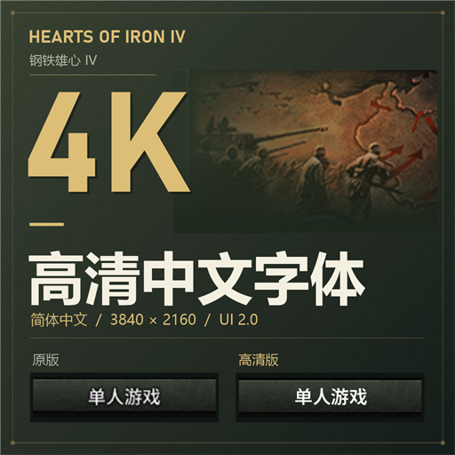
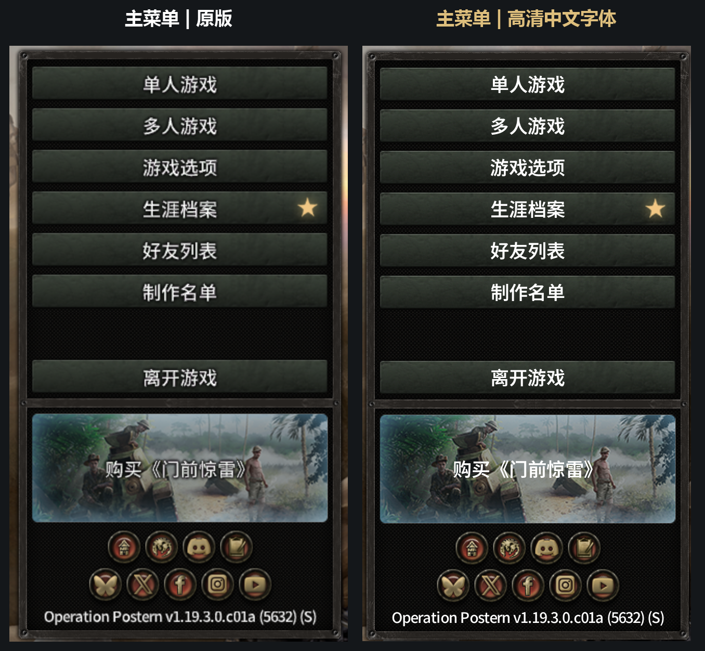
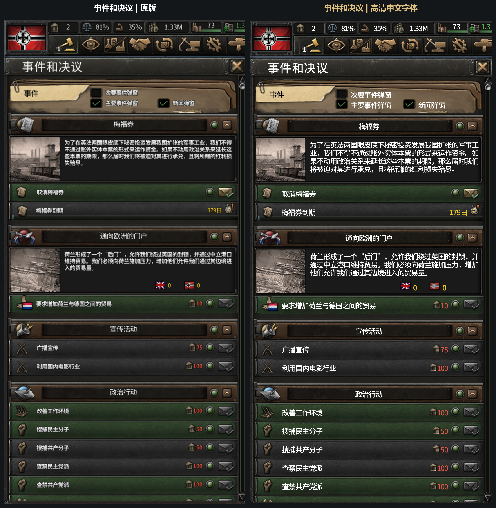
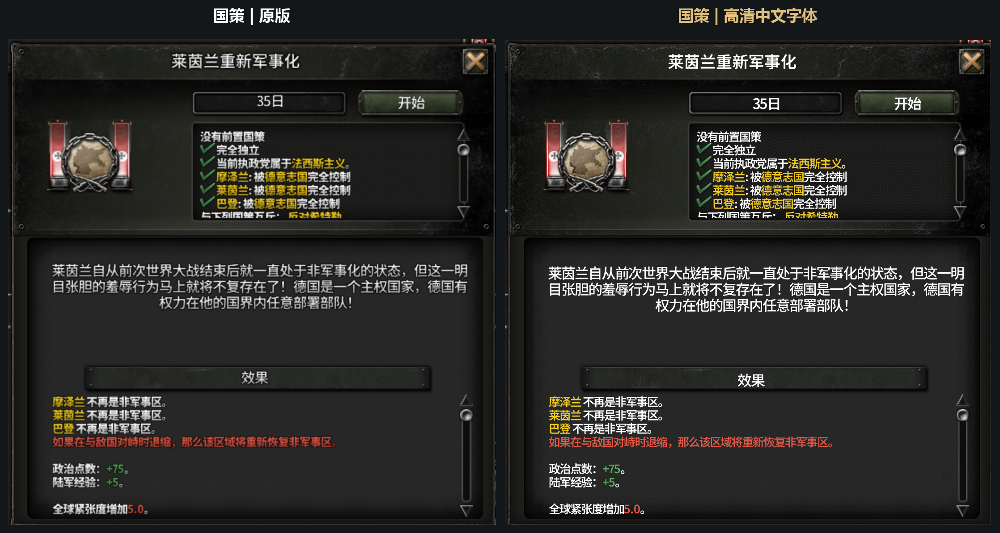
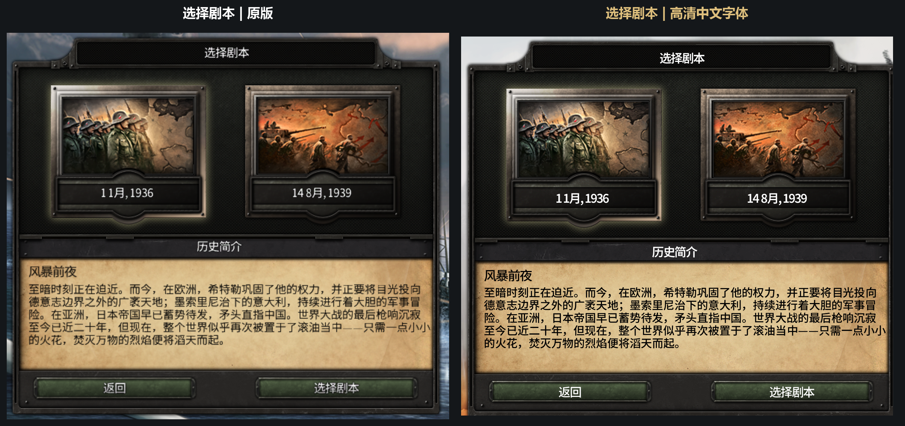

# 钢铁雄心 IV｜4K 高清中文字体

针对 **3840 × 2160、UI Scaling 2.0、简体中文**制作的高清字体适配。
基于 [Chris Spoelstra / cspoelstra 的 HOI4-HiDPI](https://github.com/cspoelstra/HOI4-HiDPI)，
经原作者同意，以独立 fork 和 Mod 维护。

[Steam 创意工坊](https://steamcommunity.com/sharedfiles/filedetails/?id=3822834833) ·
[原项目文档](README.upstream.md) · [技术说明](docs/schinese/implementation.md)



## 使用与支持范围

1. 在启动器中启用本模组，使用简体中文。
2. 分辨率设为 **3840 × 2160**，**UI Scaling (Experimental)** 设为 **2.0**，重新启动游戏。
3. 本模组已包含所需高清字体和着色器，无需额外订阅原版 HiDPI Text。

实测环境为 **Windows、HOI4 1.19.3、DirectX 11、4K、UI 2.0**。
用户已完成独立安装及多轮游戏内界面检查。其他分辨率、缩放、渲染器、版本、系统及大型模组
尚未完整验证；不据原项目的测试推断本中文版也支持。铁人模式与成就兼容性尚未单独验证。

替换相同字体、`gfx/FX` 着色器或同名 `interface` 文件的模组可能冲突。
日文、韩文与繁体中文不在本版本支持目标中。

## 实机对比

左侧原版，右侧中文高清版。截图由玩家提供，按原始像素尺寸并排，仅增加标题栏；
未额外锐化或人为模糊任何一侧。两侧原始裁切边界略有差异。






## 源码内容与状态

- `build_mod.py`、`hidpi/`：中文字体轮廓重绘、图集拆页、纯填充处理及基础界面映射源码。
- `schinese/release-patches.json`：最终 117 个界面/着色器文本文件的源变更及 111 个字体对齐别名参数。
  原游戏未修改的部分从用户本机读取；原游戏完整文件不上传。
- `schinese/apply_release_patches.py`：应用上述变更，输入/输出哈希不匹配时停止。
- `schinese/accepted-payload.json`、`schinese/verify_release.py`：1082 个已验收运行文件的 SHA-256 清单与检查工具。
- `fonts/NotoSansSC-SemiBold.ttf`：测试使用的 Noto Sans SC 字重 600 静态实例，附 OFL 授权。
- `tests/`：字体填充、拆页及源补丁回归检查。
- `workshop/schinese/`：中文封面和介绍；上游 `workshop/` 资源保留。

**构建状态：**验收包经历多阶段构建与游戏内修正。基础生成器、最终源补丁和结果清单均已收录，
但尚未整理并验证“一条命令从零生成与验收包逐文件相同结果”的完整流程。
下列基础字体构建是开发入口，不能当作验收安装包的等价替代。
最终补丁会检查游戏文件版本；字体别名还需要验收包中的基础字体资源。
生成的 DDS/TGA 大图集、个人目录、临时回退文件及游戏原文件不在 Git 中。

## 开发构建

使用 Python **3.11 或更新版本**：

```bash
python -m pip install -r requirements.txt
python -m unittest discover -s tests -v
python build_mod.py --help
```

完整构建沿用上游对 `fontconfig`（`fc-match`）、`potrace`、Ubuntu / URW Gothic / Liberation
字体包的依赖；建议在 Linux 或 WSL 中配置。CJK 选择 `dxt5` 格式时还需要 ImageMagick 的 `magick`。
缺少上游轮廓字体会回退为位图描摹，生成结果会不同。

先生成一组基础中文字体进行开发检查（将游戏路径换成自己的路径）：

```bash
python build_mod.py --game "/path/to/Hearts of Iron IV" \
  --cjk-font fonts/NotoSansSC-SemiBold.ttf \
  --cjk-groups standard --cjk-dds-format raw --jobs 2 --out ./dist-schinese
```

省略 `--cjk-groups` 将构建所有受支持中文 UI 字体组，耗时和内存需求显著增加。
默认中文 Mod 目录为 `dist-schinese/hoi4_hidpi_schinese`。
此命令不修改已安装 Mod；不要用开发输出覆盖验收版本。
`--install` 会替换同名已安装 Mod，仅在备份后对自己的测试目录使用。

最终界面与着色器补丁可以单独复核，输出目录必须不存在：

```bash
python -m schinese.apply_release_patches --game "/path/to/Hearts of Iron IV" \
  --out ./dist-schinese-text-overlay --text-only
```

同时重建已验收字体的对齐别名时，提供解包后 Mod 根目录：

```bash
python -m schinese.apply_release_patches --game "/path/to/Hearts of Iron IV" \
  --base-mod "/path/to/accepted/hoi4_hidpi_schinese" --out ./dist-schinese-overlay
python -m schinese.verify_release "/path/to/accepted/hoi4_hidpi_schinese"
```

补丁输出仅为需叠加至基础 Mod 的文件集合，**不是可独立启用的完整 Mod**。
工具不修改游戏安装目录或提供的基础 Mod。
游戏更新或重新生成字体布局导致哈希变化时，需要审查并更新补丁记录，不能强行套用。

## 授权与反馈

代码沿用 [MIT](LICENSE)，保留原作者署名。
中文适配与测试：七海从小就很可爱 / [zsr71](https://github.com/zsr71)。
Noto Sans SC 使用 [SIL Open Font License 1.1](licenses/NotoSansSC-OFL.txt)，
静态实例来自 [Google Fonts Noto Sans SC](https://github.com/google/fonts/tree/main/ofl/notosanssc)。
Podkova 及其他上游字体许可见 `licenses/` 和[上游文档](README.upstream.md#license)。
游戏截图、由游戏文件衍生的补丁内容和其他游戏资产的权利仍属于 Paradox Interactive；
它们不因代码使用 MIT 而变为 MIT 资产。

反馈缺字、模糊或位置异常时，请在 Issues 附游戏版本、分辨率、UI 缩放、渲染器、
同时启用的字体/界面模组和对应页面截图。

## English

This is an independent Simplified Chinese adaptation of
[cspoelstra/HOI4-HiDPI](https://github.com/cspoelstra/HOI4-HiDPI), published with the original author's permission.
Tested on Windows, HOI4 1.19.3, DX11, 3840×2160 and UI scale 2.0.
It includes the Chinese atlas generator, final shader/UI source edits, font alignment recipes,
licences and real in-game comparisons. The generator is a development entry point: an end-to-end,
byte-identical rebuild of the accepted multi-stage package has not yet been established.
The final patch tool reads the user's installed game and checks input/output hashes;
alias reconstruction additionally requires the accepted base fonts.
See [implementation notes](docs/schinese/implementation.md) and the [upstream README](README.upstream.md).
